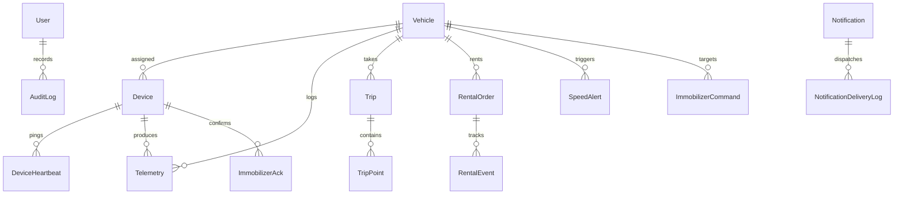

# FleetGuard - System Architecture & Engineering Specifications

## 1. High-Level Architecture Overview

FleetGuard is an IoT-based vehicle telemetry, real-time live GPS tracking, security, and rental fleet management platform. It integrates embedded vehicle hardware (ESP32 microcontroller with cellular and GPS modems) with a modern reactive web dashboard over bi-directional HTTP and WebSocket protocols.

```
+-------------------------------------------------------------------------+
|                              VEHICLE HARDWARE                           |
|                                                                         |
|  +--------------------+         UART1         +----------------------+  |
|  | NEO-6M GPS Module  | --------------------> | ESP32 Microcontroller|  |
|  +--------------------+ (9600 Baud NMEA 0183) |                      |  |
|                                               |  - TinyGPSPlus Engine|  |
|  +--------------------+         UART2         |  - Network Driver HAL|  |
|  | SIM800L Cellular   | <===================> |  - Offline Buffer    |  |
|  | (2G GPRS Modem)    | (9600 Baud AT Client) |  - Safety Interlock  |  |
|  +--------------------+                       +----------------------+  |
|                                                           |             |
|                                                           | GPIO23      |
|                                                           v             |
|                                               +----------------------+  |
|                                               | Optocoupler Relay    |  |
|                                               | (Ignition Interlock) |  |
|                                               +----------------------+  |
+-------------------------------------------------------------------------+
                                    |
                                    | Cellular GPRS / TCP/IP (HTTP REST)
                                    v
+-------------------------------------------------------------------------+
|                        FLEETGUARD BACKEND ENGINE                        |
|                                                                         |
|  +-------------------------------------------------------------------+  |
|  | Express REST API & Ingestion Router                               |  |
|  | - Device Token Authentication (x-device-token / HMAC)             |  |
|  | - GPS Coordinate & Sub-Second Displacement Jump Filter            |  |
|  | - Great-Circle Haversine Distance Engine                          |  |
|  | - Speed Violation Evaluator (Rate-Limited Cooldown)               |  |
|  | - Rental Geofence & Boundary Tracking Engine                      |  |
|  | - Safe Multi-Stage Immobilizer State Machine                      |  |
|  +-------------------------------------------------------------------+  |
|            |                                            |               |
|            v                                            v               |
|  +-------------------+                        +----------------------+  |
|  | SQLite / Postgres |                        | WebSocket Server     |  |
|  | (Prisma ORM)      |                        | (Real-time Broadcast)|  |
|  +-------------------+                        +----------------------+  |
|            |                                            |               |
|            v                                            |               |
|  +-------------------+                                  |               |
|  | Telegram Bot API  |                                  |               |
|  | Webhook Service   |                                  |               |
|  +-------------------+                                  |               |
+-------------------------------------------------------------------------+
                                                          |
                                                          | WebSockets / JSON
                                                          v
+-------------------------------------------------------------------------+
|                         FLEETGUARD DASHBOARD UI                         |
|                                                                         |
|  - Real-time Google Maps & Vector Radar Live Tracking                   |
|  - Sub-second Heading Rotation & Speed Gauges                           |
|  - Fleet Vehicle Registry & Odometer Monitoring                         |
|  - IoT Device Watchdog & Heartbeat Status Supervision                   |
|  - Rental Order Management & Distance Allowance Progress Bars           |
|  - 5-Stage Controlled Safe Engine Immobilizer Console                   |
|  - Unified Event History & CSV Export                                   |
|  - Light / Dark Mode Automotive Design System                           |
+-------------------------------------------------------------------------+
```

---

## 2. Telemetry Ingestion & Data Validation Pipeline

1. **Authentication**: All telemetry from devices passes through `requireDeviceAuth` checking `x-device-token`.
2. **Coordinate Sanity**: Validates latitude is between -90 and 90, longitude between -180 and 180, and strictly rejects Null Island (`(0.0, 0.0)`).
3. **Sub-Second & Impossible Jump Filtering**:
   - Calculates Haversine distance from the previous confirmed GPS point.
   - Evaluates implied velocity: if displacement exceeds `GPS_MAX_DISTANCE_JUMP_KM` (default 5 km) within 60s, or implied speed exceeds `GPS_MAX_VALID_SPEED_KMH` (default 200 km/h), the packet is rejected and flagged as `JUMP_FILTERED`.
4. **Stationary GPS Drift Filter**: If vehicle velocity is `< 2.5 km/h`, distance delta is clamped to `0.0 km`, eliminating phantom mileage while parked.
5. **Accumulation**: Distance is added to the active trip and active rental contract.
6. **Speed Alert Evaluation**: Checked against vehicle or rental threshold. A configurable cooldown window (default 120s) prevents notification spam while cruising.
7. **Broadcast**: Dispatched in real time to connected browser WebSocket clients.

---

## 3. Database Entity Relationship Diagram


